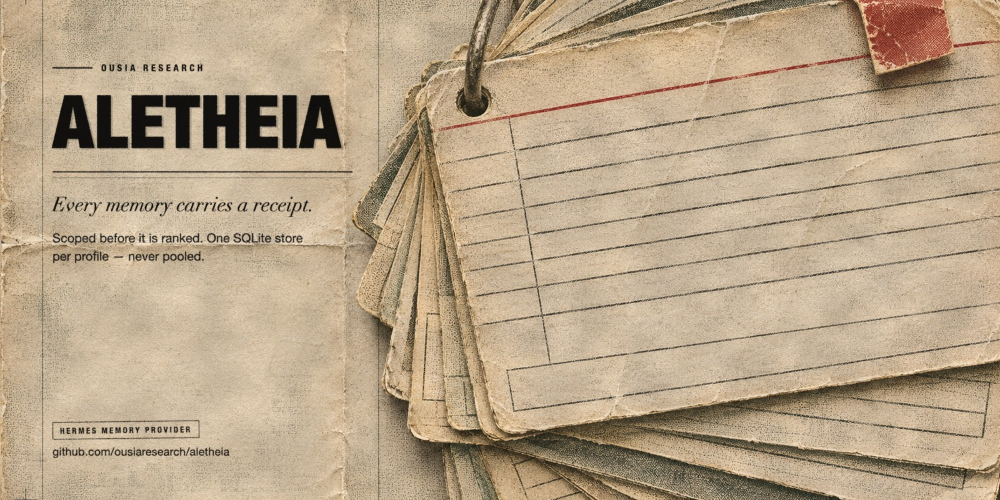

# Aletheia



Evidence-bound scoped memory for people and their agents.

Aletheia writes conversations, documents and media into a scoped, auditable store inside your own
profile. Recall is scoped first, ranked second, and explained in a receipt naming the scope
consulted and the ids selected. Deletions cascade, corrections preserve lineage, and nothing
retrieved is ever injected whole.

One repository, one name: this is both the substrate (the `aletheia` package) and the Hermes
plugin that register it as an external memory provider.

## Status

2.0.0. The substrate, scope engine, ingestion, retrieval, reasoning loop, HTTP server and the Hermes
memory provider are implemented and reviewed through phase 14. The major version marks the rename
from Weft to Aletheia: distribution, import path, CLI, environment variables, tool names and default
store path all changed together, and an existing store is moved into place on first run rather than
abandoned. `scripts/test.sh` runs the current suite: 1051 checks. AGPL-3.0.

## Install

### As a Hermes memory provider (the usual way)

```bash
hermes plugins install ousiaresearch/aletheia      # installs disabled
hermes plugins enable aletheia                      # then opt in
hermes config set memory.provider aletheia
```

Admission to the Hermes plugin catalog is a separate, human-reviewed PR; until that lands, install by
`owner/repo` as above or pin a commit with `--ref <sha>`.

### As a Python package

```bash
pip install ousia-aletheia
```

The import name is `aletheia`; the distribution is `ousia-aletheia` because `aletheia` and
`aletheia-memory` both belong to other people on PyPI. `pip install aletheia` would install
someone else's package, so don't.

The provider needs the embedder and the cross-encoder reranker on disk; `aletheia models fetch`
(`python -m aletheia.cli models fetch`) pulls them. A missing model is reported, never papered over
with a keyword fallback.

### From source

```bash
git clone https://github.com/ousiaresearch/aletheia.git
cd aletheia
python3 -m venv .venv
source .venv/bin/activate
pip install -e ".[server]"
```

Python >= 3.11 required. The `server` extra installs the HTTP server only; it does not install
sentence-transformers or any embedder. The default local embedder (an MLX BGE-M3 snapshot,
`local-embedding` extra) runs on darwin/arm64 only.

### Upgrading from Weft

Nothing to migrate by hand. On first run Aletheia moves `<profile>/weft/weft.sqlite3` (with its
WAL), `<profile>/weft/provider-config.json` and `~/.weft/weft.sqlite3` to the Aletheia paths. An
existing store at the new path always wins; a legacy file that loses the race is left where it is,
never deleted.

## Boundaries

- Aletheia is not a brain, a consciousness, or a proof of either.
- It does not post, message, or commit on its own.
- Recall is data, not instructions. Retrieved text cannot authorize writes or alter scope.
- Scope is deterministic and deny-by-default. Identity grants nothing.

## Install

### From PyPI (alpha)

```bash
pip install aletheia==0.1.0a0
```

### From source

```bash
git clone https://github.com/ousiaresearch/aletheia.git
cd aletheia
python3 -m venv .venv
source .venv/bin/activate
pip install -e ".[server]"
```

Python >= 3.11 required. The `server` extra installs the HTTP server only; it does not install
sentence-transformers or any embedder. The default local embedder (an MLX BGE-M3 snapshot,
`local-embedding` extra) runs on darwin/arm64 only.

## Optional external LLM features (explicit opt-in)

Fact extraction and query expansion can use an operator-selected LLM. Aletheia has no default
provider and does not silently choose or contact one. The client supports native OpenAI and
Anthropic APIs, plus arbitrary OpenAI-compatible endpoints (including compatible gateways).
Configure the provider, model, and credentials in the process environment:

```bash
# Native Anthropic example
export ALETHEIA_LLM_PROVIDER=anthropic
export ALETHEIA_LLM_MODEL='<model-id>'
export ANTHROPIC_API_KEY # load it from your secret manager before starting Aletheia

# Or native OpenAI: ALETHEIA_LLM_PROVIDER=openai, OPENAI_API_KEY=...
# For an OpenAI-compatible service, also set:
# ALETHEIA_LLM_PROVIDER=openai-compatible
# ALETHEIA_LLM_BASE_URL='<provider's API base URL>'
# ALETHEIA_LLM_MODEL='<provider's exact model id>'
# ALETHEIA_LLM_API_KEY_ENV='<name of the environment variable holding the key>'
```

Aletheia reads the key from the named environment variable; it does not read Hermes auth files
or copy credentials into project configuration. Make the secret available to the Aletheia process
through your existing secret manager. For fact extraction, external transmission remains disabled
unless you pass `--allow-external` (or set `ALETHEIA_EXTRACT_ALLOW_EXTERNAL=1`). The selected host
is printed to stderr before any request. Query expansion is separately disabled unless the caller
explicitly supplies it or sets `ALETHEIA_QUERY_EXPANSION=1`. The CLI and HTTP server make no other
external calls.

## Quick start

`ingest` and hybrid `recall` need the local embedder (darwin/arm64, see above).

```bash
aletheia --db ~/.aletheia/aletheia.sqlite3 ingest --scope coast --file note.md
aletheia --db ~/.aletheia/aletheia.sqlite3 recall --scope coast --query "tides"
aletheia --db ~/.aletheia/aletheia.sqlite3 rebuild-fts --scope coast
```

To serve over HTTP, `ALETHEIA_API_KEY` and `ALETHEIA_KNOWN_SCOPES` **must be set**; the server fails
closed, so without them every request returns 401 (no or wrong key) or 403 (scope not
allowed):

```bash
export ALETHEIA_API_KEY='replace-with-a-long-random-secret'
export ALETHEIA_KNOWN_SCOPES='coast'
aletheia --db ~/.aletheia/aletheia.sqlite3 serve --host 127.0.0.1 --port 8765
```

HTTP recall is lexical-only. The Docker image and Compose file are **unverified**: Docker was
not available to build or run them. See `docs/turnkey-deployment.md`.

Default database: `~/.aletheia/aletheia.sqlite3` (owner-only, 0600).

Deletion commits logical erasure immediately, but deleted text can remain in the live `-wal` file until a checkpoint completes, and backups, exports and snapshots are never erased. See "Deletion and erasure" in `docs/turnkey-deployment.md`.

## Models

Aletheia ships adapters, not weights. Aletheia requires Apple Silicon macOS, the MLX BGE-M3
embedder and the cross-encoder reranker; it does not fall back to keyword-only retrieval.
In the **same Python environment as Hermes**, install Aletheia's model dependencies and download
the models while online (review the model cards and licences before downloading):

```bash
python -m pip install 'aletheia[local-embedding,local-recall]'
python -c "from huggingface_hub import snapshot_download; snapshot_download('mlx-community/bge-m3-mlx-4bit'); snapshot_download('cross-encoder/ms-marco-MiniLM-L-6-v2')"
```

The `local-recall` extra requires `sentence-transformers>=3.0` for local-only cross-encoder loading.

Model cards: [BGE-M3 MLX](https://huggingface.co/mlx-community/bge-m3-mlx-4bit) and
[MiniLM reranker](https://huggingface.co/cross-encoder/ms-marco-MiniLM-L-6-v2). The embedder
currently requires the default `~/.cache/huggingface/hub` location, so do not override `HF_HOME`
or `HF_HUB_CACHE` for its download. The reranker uses the Hugging Face cache configuration.
Restart the gateway after setup. Provider readiness loads and probes both models locally; this can
take time and memory on startup. There is no `aletheia models fetch` command or built-in licence
consent flow. Optional media models are separate.

## Design invariants

1. Scope before relevance.
2. Deny by default.
3. Content, not location, sets scope.
4. Identity grants no scope.
5. Cross-scope needs user-attributable request.
6. Composite artifacts never injectable.
7. Status transitions gated (verified requires Verification record).
8. User attribution for Decision/Commitment.
9. Correction supersedes, keeps lineage.
10. Recall is not re-ingested.
11. Authority is singular (Substrate is only authority).
12. Fail closed.
13. Retrieved content is data, not instructions.

## License

AGPL-3.0. See `LICENSE`.

Third-party dependency licences are listed in `docs/clean-room-provenance.md`. Arsumbris, Honcho, and OpenViking are study-only under clean-room protocol; no source copied or bundled.